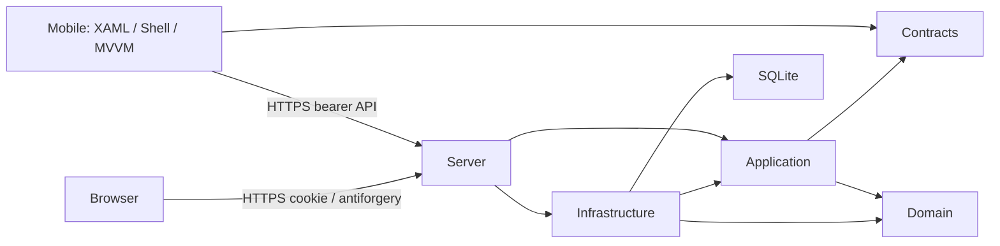
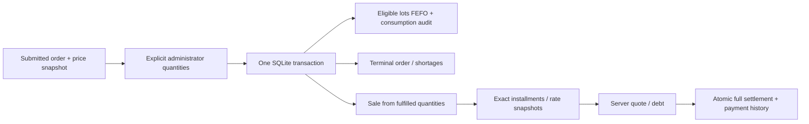

# Architecture — actual implementation at Phase06

.NET SDK10.0.401; EF Core/Identity10.0.12; MAUI10.0.20; CommunityToolkit.Mvvm8.4.2; xUnit. One ASP.NET Core host serves API and Razor Pages. SQLite is accessed exclusively by the server. Eight projects remain; no additional frontend/framework, broker, scheduler or microservice.

## Dependencies and request paths

Domain is pure C# entities/invariants. Contracts contains DTOs/shape validation. Application owns customer/product/order/fulfillment/finance/administration use cases and EF-free persistence/current-user ports. Infrastructure implements EF mappings, migrations, Identity, reference data, seeding and stores. Server composes services, validation/ProblemDetails and authorized API/Razor handlers. Page handlers invoke application services directly; no HTTP self-calls or duplicated FEFO/finance arithmetic.

Mobile references Contracts only. Client contains reusable cancellable HTTPS/session abstractions; Services implements SecureStorage, Preferences, Shell navigation/dialogs and BRL display. ViewModels use ObservableObject/AsyncRelayCommand; Views are XAML and lifecycle/query wiring. Pure client/VM sources are linked into integration tests; those tests do not prove native XAML behavior.

## Authentication and ownership
Admin website: Identity password hashing, secure HttpOnly SameSiteLax two-hour cookie, local redirects and antiforgery on state-changing forms. API policies explicitly use protected opaque bearer tokens (30minutes), validating active user, security stamp and current roles per request. No public signup or exposed refresh endpoint. Logout rotates security stamp. API/account routes require HTTPS.

Customer/history/debt/sale/installment/payment reads use current customer assignment. Orders require original salesperson authorship plus current assignment. Administrative mutations check role at policy and service layers. See ADR-002 for the academic identity choice; production needs standards-based identity, secure HTTPS, persistent protected keys and deployment operations.

Native sessions are encrypted in platform SecureStorage, bound to exact HTTPS origin and expiry, validated through /me, and cleared on401/403/logout. No password or refresh token is stored. Defaults: Windows localhost; detected Android virtual device10.0.2.2; physical device explicit address. Only Debug supports an explicitly entered exact valid localhost certificate SHA256 pin; Release has no custom validation callback. No cleartext allowance.

## Workflow and money

Allocation validates every selected line/version, future dispatch and approved quantity, then consumes valid lots sorted by expiry then ID. It never assigns customer priority. Stock/order/batch/movements flush before finance, but both flushes commit together. Zero allocation becomes Cut without finance. Matching request-key/content retries return the original outcome; changed content/re-finalization conflicts.

A process-local asynchronous writer gate plus SQLite Serializable non-deferred transaction protects workflow writes. Scoped tracking is cleared before fresh reads; Guid versions, uniqueness, foreign keys and CHECK constraints provide additional protection. SQLite busy wait is bounded at five seconds; stale/busy conflicts are409. This is a single-server solution, not a horizontally deployed stock system. Cancellation/transaction disposal rolls back and releases the gate.

Payment validates administrator, original key, quote date/version and exact server-calculated amount. Paid state and component history commit atomically. Full installments only; no partial credits/refunds/reversals.

Stored monetary values are long INTEGER cents; rates are integer basis points. Decimal AwayFromZero rounding applies per component; final installment receives remainder. Terms10/20 have immutable seeded definitions. Sales snapshot prices and receivables snapshot configured rates. Rates are validated at startup; restart config changes affect new receivables only. DateOnly is business date; audit timestamps UTC; today/dispatch use America/Sao_Paulo. Open/Paid persist; Overdue is derived. No scheduled jobs.

## Persistence and model
Entities: Identity users/roles, salesperson, state/city/customer, group/product/inventory lot, order/items, allocation batch, lot consumption, sale/items, payment term/definitions, accounts receivable/payment record. AllocationBatch exists for idempotency and actor/time audit, including all-zero cuts.

Default file: %LOCALAPPDATA%/VanderCake/vandercake.db outside OneDrive. Connection string may explicitly override it. Normal startup never migrates/seeds/resets. Explicit --migrate applies EF migrations; --seed-demo requires Development and externally supplied passwords. Existing passwords and stock balances remain unchanged.

Applied migrations:20261022002255_InitialDomainAndIdentity and20261022004717_AllocationBatchAudit. No Phase06 schema change or model drift. EF CLI uses Infrastructure as both project and startup because its design-time factory/package live there. Migration upgrade preserves legacy records in tests; SQLite table rebuild emits a nontransactional foreign-key PRAGMA warning. Stop the app and use consistent backups for maintenance; interrupted migration recovery/power-loss testing is NOT RUN.

## Demo lifecycle and current limits
Optional Demo:AcademicFixture=true is read only inside explicit Development seeding. It adds XYZ at1000c with6+9 valid units and EX235 at23500c with1unit, once by product code. It never replenishes consumed lots. Existing base seed provides one administrator, one salesperson, three customers and four bakery product categories.

Prepare-AcademicDemo.ps1 uses only existing authenticated APIs. It records original submission/allocation/payment payloads before mutations in nonsecret LocalAppData manifests, allowing exact retry after uncertain responses. -Complete explicitly chooses4/5/6 and one separate235.00 example; this is not an automatic allocator. Interactive manual completion and scripted completion are separate rehearsal choices. An expired uncommitted request/quote requires deliberate review; manifests are never silently reset.

Orders have at most100lines, allocations100orders, quantities1..1million, monetary totals at most1trillion cents. Several lists cap at500 without paging. Native pending orders are memory-only; after process death check server history before resubmission. Group deactivation/unconsumed-lot correction are incomplete auxiliary requirements. See coverage/backlog for all gaps.

Fresh Phase06 evidence:116 tests; full Debug solution Windows/Android; real HTTPS exact demo/retry and restart proof;12 authenticated Razor routes; applied migrations/no model drift. Prior phases provide actual Windows native and web visual evidence. Android interactive flow, physical devices, formal accessibility, Release packaging and load/power-loss tests remain unverified.
